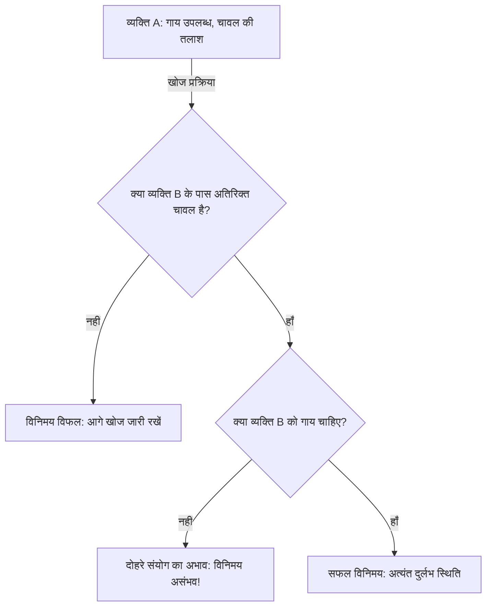
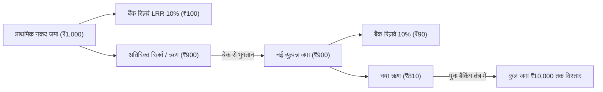
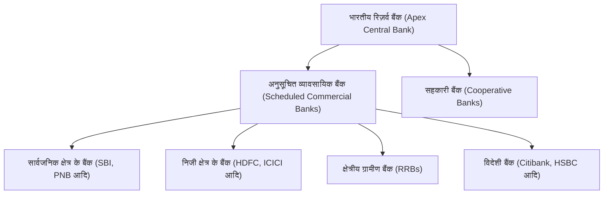
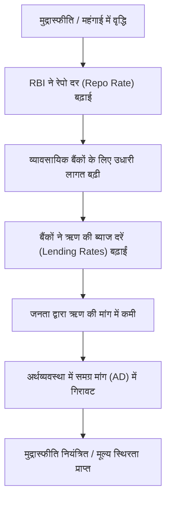

# Class 12 Macroeconomics – Chapter: Money and Banking (मुद्रा और बैंकिंग)
## संपूर्ण विस्तृत, संप्रत्ययात्मक एवं परीक्षा-उन्मुख अध्ययन गाइड (Comprehensive NCERT & CBSE Master Guide)

---

# 1. Chapter Introduction (अध्याय परिचय)

### मुद्रा (Money) का अर्थ और परिचय
आधुनिक अर्थव्यवस्था में 'मुद्रा' (Money) आर्थिक जीवन की रीढ़ है। साधारण शब्दों में, मुद्रा वह कोई भी वस्तु है जिसे वस्तु विनिमय के माध्यम (Medium of Exchange), मूल्य के मापक (Measure of Value), संचय के साधन (Store of Value) तथा स्थगित भुगतानों के मान (Standard of Deferred Payments) के रूप में सामान्य स्वीकृति (General Acceptability) प्राप्त हो। जब तक मुद्रा का आविष्कार नहीं हुआ था, तब तक आर्थिक गतिविधियां अत्यंत सीमित और कठिन थीं।

### Banking System (बैंकिंग प्रणाली) का परिचय
बैंकिंग प्रणाली किसी भी देश के वित्तीय तंत्र का हृदय होती है। यह समाज के बचतकर्ताओं (Savers/Surplus Units) से धन जमा के रूप में स्वीकार करती है और उसे उत्पादक क्षेत्रों (Borrowers/Deficit Units/Investors) को ऋण के रूप में उपलब्ध कराती है। भारत में बैंकिंग तंत्र का शीर्ष संगठन **भारतीय रिज़र्व बैंक (Reserve Bank of India - RBI)** है, जो सभी व्यावसायिक बैंकों (Commercial Banks) का नियमन व पर्यवेक्षण करता है।

### इस Chapter का मुख्य उद्देश्य
1. वस्तु विनिमय प्रणाली की कमियों और मुद्रा के उद्भव को समझना।
2. मुद्रा की परिभाषा, उसके वैधानिक रूप और मुद्रा के विभिन्न कार्यों का विश्लेषण करना।
3. देश में मुद्रा की कुल पूर्ति (Money Supply) और उसके विभिन्न मापों ($M_1, M_2, M_3, M_4$) की गणना सीखना।
4. व्यावसायिक बैंकों द्वारा साख निर्माण (Credit Creation / Deposit Creation) की प्रक्रिया को गणितीय व तार्किक रूप से समझना।
5. केंद्रीय बैंक (RBI) के प्रमुख कार्यों तथा साख नियंत्रण के मौद्रिक उपकरणों (Repo Rate, Reverse Repo Rate, CRR, SLR, OMO आदि) का गहन अध्ययन करना।

### दैनिक जीवन और समष्टि अर्थव्यवस्था में महत्व
- **दैनिक जीवन में:** दैनिक लेनदेन, वेतन भुगतान, वस्तुओं और सेवाओं की खरीदारी, बचत और निवेश सभी मुद्रा और बैंकों के माध्यम से संचालित होते हैं।
- **समष्टि अर्थव्यवस्था (Macroeconomics) में:** मुद्रा की मात्रा और ऋण की उपलब्धता सीधे तौर पर देश में कुल मांग (Aggregate Demand), उत्पादन (Output), रोजगार (Employment) और मुद्रास्फीति (Inflation / महंगाई) को तय करती है।

---

# 2. Detailed Topic-wise Explanation (विषयवार विस्तृत व्याख्या)

इस अध्याय में NCERT के अनुसार मुख्य तीन स्तंभ हैं:
1. **मुद्रा (Money):** उद्भव, कठिनाइयाँ, कार्य और मुद्रा आपूर्ति के माप।
2. **व्यावसायिक बैंक (Commercial Banks):** कार्य और साख निर्माण की प्रक्रिया (Deposit Multiplier Mechanism)।
3. **केंद्रीय बैंक (Central Bank - RBI):** कार्य और मौद्रिक नीति द्वारा साख का नियंत्रण (Quantitative and Qualitative Tools)।

प्रत्येक विषय का अध्ययन उसकी परिभाषा, कार्यप्रणाली, व्यावहारिक महत्व और बोर्ड परीक्षा की दृष्टि से किया गया है।

---

# 3. Money and Its Functions (मुद्रा और इसके कार्य)

## 3.1 Meaning of Money (मुद्रा का अर्थ)
> **परिभाषा:** मुद्रा कोई भी ऐसी वस्तु है जिसे सामान्य रूप से विनिमय के माध्यम, मूल्य के सामान्य मापक, मूल्य के संचय और भविष्य के भुगतानों के आधार के रूप में कानूनन या सामाजिक रूप से स्वीकार किया जाता है।
> *"Money is what money does."* (मुद्रा वही है जो मुद्रा का कार्य करे - वाकर)

## 3.2 Barter System (वस्तु विनिमय प्रणाली - C-C Economy)
- **अर्थ:** वह प्रणाली जिसमें वस्तुओं और सेवाओं का विनिमय सीधे अन्य वस्तुओं और सेवाओं से बिना किसी मुद्रा के उपयोग के किया जाता है। इसे **C-C Economy** (Commodity-for-Commodity Economy) भी कहा जाता है।
- **उदाहरण:** एक किसान द्वारा एक क्विंटल गेहूं देकर बुनकर से 5 मीटर कपड़ा लेना।

## 3.3 Double Coincidence of Wants (आवश्यकताओं का दोहरा संयोग)
- **अर्थ:** वस्तु विनिमय की अनिवार्य शर्त यह है कि दोनों पक्षों के पास वह वस्तु होनी चाहिए जिसकी दूसरे पक्ष को आवश्यकता हो।
- **समस्या:** यदि व्यक्ति A के पास गाय है और उसे चावल चाहिए, तो उसे ऐसा व्यक्ति B ढूंढना होगा जिसके पास अतिरिक्त चावल हो और जिसे ठीक उसी समय गाय की आवश्यकता हो। व्यावहारिक जीवन में ऐसा संयोग मिलना अत्यंत दुर्लभ होता है।

## 3.4 Difficulties / Drawbacks of Barter System (वस्तु विनिमय प्रणाली की कमियां)
1. **आवश्यकताओं के दोहरे संयोग का अभाव (Lack of Double Coincidence of Wants):** विनिमय तभी संभव था जब दोनों की मांगें एक-दूसरे से मेल खाएं, जिससे व्यापार में भारी समय और खोज लागत (Search Cost) लगती थी।
2. **मूल्य के उभयनिष्ठ मापक का अभाव (Lack of Common Measure of Value / Unit of Account):** वस्तुओं के मूल्य को मापने की कोई साझा इकाई नहीं थी। उदाहरण के लिए, 1 गाय = कितने किलो चावल? या 1 घोड़ा = कितनी बोरियां गेहूं? प्रत्येक वस्तु का मूल्य अन्य सभी वस्तुओं के संदर्भ में याद रखना असंभव था।
3. **स्थगित भुगतानों के मान का अभाव (Lack of Standard of Deferred Payments):** भविष्य में किए जाने वाले भुगतान (जैसे ऋण और उसका ब्याज, श्रमिकों का भविष्य का वेतन) वस्तुओं के रूप में करना कठिन था, क्योंकि वस्तुओं की गुणवत्ता में अंतर आ सकता था और उनके मूल्य में अत्यधिक उतार-चढ़ाव होता था।
4. **मूल्य के संचय में कठिनाई (Difficulty in Storing Wealth / Value):** अधिकांश वस्तुएं (जैसे फल, सब्जियां, पशु, अनाज) नाशवान (Perishable) होती हैं। उन्हें लंबे समय तक बिना खराब हुए और बिना भारी भंडारण लागत (Storage Cost) के संचित नहीं रखा जा सकता था।
5. **वस्तुओं की अविभाज्यता (Indivisibility of Certain Goods):** कुछ वस्तुएं ऐसी होती हैं जिन्हें बिना नष्ट किए छोटे टुकड़ों में नहीं बांटा जा सकता। यदि एक व्यक्ति के पास एक घोड़ा है और वह केवल एक किलो सेब खरीदना चाहता है, तो घोड़े को विभाजित नहीं किया जा सकता।

## 3.5 Evolution of Money (मुद्रा का क्रमिक विकास)
1. **वस्तु मुद्रा (Commodity Money):** सीपियां, नमक, चमड़ा, अनाज, पशु आदि।
2. **धातु मुद्रा (Metallic Money):** सोने, चांदी, तांबे और कांसे के सिक्के।
3. **कागजी मुद्रा (Paper Currency):** केंद्रीय बैंक और सरकार द्वारा जारी किए गए प्रॉमिसरी नोट।
4. **साख मुद्रा (Credit / Bank Money):** बैंक चेक, ड्राफ्ट, विनिमय बिल।
5. **प्लास्टिक और डिजिटल मुद्रा (Plastic & Electronic Money):** डेबिट कार्ड, क्रेडिट कार्ड, UPI, नेट बैंकिंग, ई-वॉलेट और अब केंद्रीय बैंक डिजिटल मुद्रा (CBDC - e₹)।

## 3.6 Functions of Money (मुद्रा के कार्य)

### A. प्राथमिक कार्य (Primary / Main Functions)
1. **विनिमय का माध्यम (Medium of Exchange):**
   - मुद्रा क्रय और विक्रय के बीच मध्यस्थ का कार्य करती है।
   - इसने क्रय (Purchase) और विक्रय (Sale) की प्रक्रिया को दो अलग-अलग चरणों में विभाजित कर दिया।
   - इसने आवश्यकताओं के दोहरे संयोग की समस्या को पूरी तरह समाप्त कर दिया।
   - *उदाहरण:* कोई भी श्रमिक अपनी मेहनत बेचकर मुद्रा प्राप्त करता है और उस मुद्रा से अपनी पसंद की कोई भी वस्तु बाजार से खरीद लेता है।
2. **मूल्य का सामान्य मापक / लेखा की इकाई (Unit of Account / Measure of Value):**
   - मुद्रा सभी वस्तुओं और सेवाओं के मूल्य को एक उभयनिष्ठ इकाई (रुपया, डॉलर) में व्यक्त करने का कार्य करती है।
   - किसी वस्तु के मुद्रा रूपी मूल्य को उसकी **'कीमत' (Price)** कहते हैं।
   - इससे राष्ट्रीय आय, लाभ-हानि, लागत और परिसंपत्तियों का लेखा-जोखा रखना संभव हुआ।
   - *उदाहरण:* हम आसानी से तुलना कर सकते हैं कि ₹50 की नोटबुक और ₹20 का पेन, दोनों का कुल मूल्य ₹70 है।

### B. द्वितीयक / गौण कार्य (Secondary Functions)
1. **स्थगित भुगतानों का मान (Standard of Deferred Payments):**
   - वे भुगतान जो तत्काल न होकर भविष्य की किसी तिथि पर किए जाने हैं (जैसे ऋण, किस्तें, भविष्य निधि, पेंशन)।
   - मुद्रा का मूल्य अपेक्षाकृत स्थिर रहता है और यह सर्वमान्य है, इसलिए ऋण लेनदेन का आधार बनती है।
   - *उदाहरण:* बैंक से ₹5,00,000 का 5 वर्ष के लिए कार लोन लेना और हर महीने ₹11,000 की EMI देना।
2. **मूल्य का संचय (Store of Value):**
   - मुद्रा को क्रय शक्ति के भविष्य के लिए संचय (Asset) के रूप में रखा जा सकता है।
   - यह पूर्णतः तरल (Liquid) परिसंपत्ति है, जिसे बिना किसी मूल्य हानि के तुरंत किसी भी वस्तु या सेवा में बदला जा सकता है।
   - *उदाहरण:* अपनी आय में से ₹10,000 बचाकर बैंक खाते या घर में नकदी रखना ताकि आपातकाल में खर्च किया जा सके।

## 3.7 Money as a Legal Tender & Classification
- **आदेश मुद्रा (Fiat Money):** वह मुद्रा जो सरकार के आदेश या फरमान (Authority of Government) द्वारा जारी की जाती है। देश के सभी नोट और सिक्के आदेश मुद्रा हैं।
- **न्यास मुद्रा (Fiduciary Money):** वह मुद्रा जो प्राप्तकर्ता और अदाकर्ता के आपसी विश्वास (Trust) पर स्वीकार की जाती है, जैसे चेक, बैंक ड्राफ्ट।
- **वैध मुद्रा (Legal Tender Money):** वह मुद्रा जिसे देश का कोई भी नागरिक किसी भी ऋण या लेन-देन के भुगतान के निपटारे के लिए अस्वीकार नहीं कर सकता।
  - *सीमित वैध मुद्रा (Limited Legal Tender):* एक निश्चित सीमा तक ही कानूनन स्वीकार करने के लिए बाध्य किया जा सकता है (जैसे भारत में 50 पैसे के सिक्के अधिकतम ₹10 तक)।
  - *असीमित वैध मुद्रा (Unlimited Legal Tender):* जिसे किसी भी मूल्य तक लेन-देन में स्वीकार करने के लिए कानूनन बाध्य किया जा सकता है (जैसे भारत में सभी कागजी करेंसी नोट और ₹1, ₹2, ₹5, ₹10, ₹20 के सिक्के)।

---

# 4. Money Supply (मुद्रा की पूर्ति)

## 4.1 Meaning of Money Supply (मुद्रा पूर्ति का अर्थ)
> **परिभाषा:** एक निश्चित समय बिंदु (Point of Time) पर देश की जनता (Public) द्वारा संचलन (Circulation) में रखी गई मुद्रा के कुल स्टॉक (Total Stock) को 'मुद्रा की पूर्ति' (Money Supply) कहते हैं।

### महत्वपूर्ण बिंदु:
- **स्टॉक अवधारणा (Stock Concept):** यह किसी निश्चित समय बिंदु (जैसे 31 मार्च) पर मापा जाता है, प्रवाह (Flow) नहीं है।
- **जनता में निहित (Held by Public):** इसमें केवल जनता (व्यक्तियों और व्यावसायिक फर्मों) के पास उपलब्ध मुद्रा शामिल होती है।
- **मुद्रा के उत्पादकों का धन शामिल नहीं:** सरकार और बैंकिंग तंत्र (RBI + Commercial Banks) के पास रखी नकदी को मुद्रा पूर्ति में शामिल नहीं किया जाता, क्योंकि वे मुद्रा के आपूर्तिकर्ता (Suppliers/Creators of Money) हैं, उपयोगकर्ता नहीं।

## 4.2 Measures of Money Supply in India (RBI के अनुसार मुद्रा पूर्ति के माप)
भारतीय रिज़र्व बैंक (RBI) 1977 से मुद्रा आपूर्ति के चार वैकल्पिक माप प्रकाशित करता है:

### 1. $M_1$ (सबसे संकीर्ण और सर्वाधिक तरल माप - Narrow Money)
$$M_1 = C + DD + OD$$
- **C (Currency held by the public):** जनता के पास रखे कागजी नोट और सिक्के।
- **DD (Demand Deposits of Commercial Banks):** व्यावसायिक बैंकों के पास जनता की मांग जमाएं (शुद्ध मांग जमाएं - Net Demand Deposits, अंतर-बैंकिंग जमाओं को छोड़कर)।
- **OD (Other Deposits with RBI):** रिज़र्व बैंक के पास अन्य जमाएं (जैसे सार्वजनिक वित्तीय संस्थाओं, विदेशी केंद्रीय बैंकों और अंतरराष्ट्रीय संस्थाओं जैसे IMF, World Bank की मांग जमाएं। इसमें भारत सरकार और वाणिज्यिक बैंकों की जमाएं शामिल नहीं होतीं)।

### 2. $M_2$
$$M_2 = M_1 + \text{डाकघर बचत बैंकों की बचत जमाएं (Savings Deposits with Post Office Savings Banks)}$$

### 3. $M_3$ (व्यापक मुद्रा - Broad Money)
$$M_3 = M_1 + \text{व्यावसायिक बैंकों की शुद्ध सावधि जमाएं (Net Time Deposits of Commercial Banks)}$$
> **नोट:** नीतिगत निर्णयों और आर्थिक विश्लेषण में $M_3$ का उपयोग सबसे अधिक किया जाता है।

### 4. $M_4$
$$M_4 = M_3 + \text{डाकघरों की कुल जमाएं (राष्ट्रीय बचत प्रमाण पत्र / NSC को छोड़कर)}$$

### तरलता का क्रम (Liquidity Order):
$$M_1 > M_2 > M_3 > M_4$$
- $M_1$ सर्वाधिक तरल (Most Liquid) है।
- $M_4$ सबसे कम तरल (Least Liquid) है।

---

# 5. Commercial Banks (व्यावसायिक बैंक)

## 5.1 Meaning of Commercial Bank (व्यावसायिक बैंक का अर्थ)
व्यावसायिक बैंक एक वित्तीय मध्यस्थ (Financial Intermediary) संस्था है जो लाभ कमाने के उद्देश्य से जनता से जमाएं स्वीकार करती है और निवेश या उपभोग के लिए ऋण प्रदान करती है।

## 5.2 Primary Functions of Commercial Banks (प्राथमिक कार्य)
1. **जमा स्वीकार करना (Accepting Deposits):**
   - **चालू खाता जमाएं (Current Account / Demand Deposits):** व्यापारियों के लिए, चेक सुविधा उपलब्ध, कोई ब्याज नहीं दिया जाता बल्कि बैंक सेवा शुल्क लेते हैं, कभी भी निकाली जा सकती हैं।
   - **बचत खाता जमाएं (Savings Account Deposits):** आम जनता की बचत के लिए, चेक सुविधा उपलब्ध, सीमित निकासी, मध्यम ब्याज दर।
   - **सावधि / फिक्स्ड डिपॉजिट (Fixed / Time Deposits):** एक निश्चित अवधि (जैसे 1 वर्ष, 5 वर्ष) के लिए जमा, चेक सुविधा नहीं होती, उच्चतम ब्याज दर।
   - **आवर्ती जमा (Recurring Deposits):** प्रति माह एक निश्चित राशि जमा करना।
2. **ऋण देना (Advancing Loans):**
   - नकद साख (Cash Credit)
   - अधिविकर्ष सुविधा (Overdraft Facility - चालू खाता धारकों को स्वीकृत सीमा तक अतिरिक्त राशि निकालने की छूट)
   - मांग ऋण (Demand Loans) और मीयादी ऋण (Term Loans)
   - विनिमय बिलों को भुनाना (Discounting Bills of Exchange)

## 5.3 Primary Deposits vs Derivative Deposits (प्राथमिक जमा बनाम व्युत्पन्न जमा)
- **प्राथमिक जमाएं (Primary / Cash Deposits):** जब कोई ग्राहक अपनी वास्तविक नकदी बैंक में जमा करता है, तो उसे प्राथमिक जमा कहते हैं। यह साख निर्माण का आधार बनती हैं।
- **व्युत्पन्न जमाएं / साख जमाएं (Derivative / Secondary Deposits):** जब बैंक किसी को ऋण देता है, तो वह उसे नकदी नहीं सौंपता, बल्कि उसके नाम से एक बैंक खाता खोलकर उसमें राशि क्रेडिट कर देता है। ऋण स्वीकृत होने से उत्पन्न इस जमा को व्युत्पन्न जमा कहते हैं।
$$\text{Total Deposits} = \text{Primary Deposits} + \text{Derivative Deposits}$$

---

# 6. Credit Creation by Commercial Banks (साख निर्माण की प्रक्रिया)

साख निर्माण या बैंक जमा सृजन (Deposit Creation) व्यावसायिक बैंकों का सबसे अनूठा और समष्टि आर्थिक दृष्टि से महत्वपूर्ण कार्य है।

## 6.1 दो मूलभूत मान्यताएं (Two Basic Assumptions)
1. **समस्त बैंकिंग प्रणाली को एक इकाई माना जाता है:** सभी व्यावसायिक बैंकों को मिलाकर एक एकल संस्था **'बैंक' (Banks)** माना जाता है।
2. **सभी लेन-देन बैंकों के माध्यम से होते हैं:** अर्थव्यवस्था में सभी प्राप्तियां और भुगतान केवल चेक/डिजिटल बैंकिंग के माध्यम से होते हैं; नकदी का संचलन न्यूनतम है।

## 6.2 विधिक आरक्षित अनुपात (Legal Reserve Ratio - LRR)
कानून के अनुसार, बैंकों को अपनी कुल जमाओं का एक निश्चित न्यूनतम प्रतिशत अपने पास और केंद्रीय बैंक के पास नकदी के रूप में रखना अनिवार्य होता है। इसे **विधिक आरक्षित अनुपात (LRR)** कहते हैं। LRR के दो भाग होते हैं:
1. **CRR (Cash Reserve Ratio):** जो रिज़र्व बैंक के पास रखना होता है।
2. **SLR (Statutory Liquidity Ratio):** जो बैंकों को स्वयं अपने पास तरल रूप में रखना होता है।

### बैंक कुल जमा का केवल एक हिस्सा ही रिज़र्व में क्यों रखते हैं?
- ऐतिहासिक अनुभव से बैंक जानते हैं कि सभी जमाकर्ता एक ही दिन अपनी पूरी जमा राशि निकालने कभी नहीं आते।
- हर दिन नए जमाकर्ता भी बैंकों में नकदी जमा करने आते रहते हैं।

## 6.3 साख गुणक का सूत्र (Credit Multiplier Formula)
$$\text{Credit Multiplier } (k) = \frac{1}{\text{LRR}}$$

$$\text{Total Deposit Creation} = \text{Initial Deposit} \times \frac{1}{\text{LRR}}$$

$$\text{Net Credit Created} = \text{Total Deposit Creation} - \text{Initial Deposit}$$

---

## 6.4 Step-by-Step Solved Detailed Example (विस्तृत संख्यात्मक उदाहरण)
- **प्रारंभिक जमा (Initial Deposit) = ₹1,000**
- **कानूनी आरक्षित अनुपात (LRR) = 10% (अर्थात 0.10)**

### प्रक्रिया का चरणबद्ध विवरण:
1. **राउंड 1 (Round 1):**
   - ग्राहक 'A' बैंक में ₹1,000 की प्राथमिक नकदी जमा करता है। बैंक की जमा = ₹1,000।
   - बैंक को LRR = 10% के अनुसार ₹100 आरक्षित निधि (Reserve) में रखना होगा।
   - अतिरिक्त आरक्षित राशि (Excess Reserves) = ₹1,000 - ₹100 = ₹900।
   - बैंक ₹900 का ऋण ग्राहक 'B' को देता है। बैंक 'B' को नकदी न देकर उसके खाते में ₹900 जमा कर देता है।
2. **राउंड 2 (Round 2):**
   - ग्राहक 'B' ₹900 का भुगतान किसी अन्य व्यक्ति 'C' को चेक द्वारा करता है।
   - व्यक्ति 'C' उस चेक को अपने बैंक खाते में जमा करता है। अब बैंकिंग प्रणाली में नई जमा = ₹900।
   - बैंक ₹900 का 10% यानी ₹90 आरक्षित निधि में रखता है।
   - शेष राशि ₹810 ($900 - 90$) बैंक ग्राहक 'D' को ऋण के रूप में दे देता है।
3. **राउंड 3 (Round 3):**
   - ₹810 पुनः बैंकिंग प्रणाली में जमा के रूप में वापस आ जाते हैं।
   - बैंक इसका 10% यानी ₹81 रिज़र्व में रखता है और ₹729 का नया ऋण स्वीकृत करता है।
4. **अंतिम स्थिति (Until Excess Reserves become Zero):**
   यह प्रक्रिया तब तक अनवरत चलती रहती है जब तक कि प्रारंभिक जमा (₹1,000) कुल कानूनी आरक्षित राशि (Total Reserves) के बराबर न हो जाए।

### तालिका: साख निर्माण की प्रक्रिया (Credit Creation Table)

| दौर (Rounds) | नई जमाएं (Deposits) (₹) | ऋण (Loans) (₹) | आरक्षित निधि (Reserves - LRR 10%) (₹) |
| :--- | :--- | :--- | :--- |
| **प्रारंभिक दौर (Round 1)** | 1,000 | 900 | 100 |
| **राउंड 2** | 900 | 810 | 90 |
| **राउंड 3** | 810 | 729 | 81 |
| **राउंड 4** | 729 | 656.10 | 72.90 |
| **... आगे के दौर ...** | ... | ... | ... |
| **कुल योग (Total)** | **₹10,000** | **₹9,000** | **₹1,000** |

### गणितीय गणना:
$$\text{साख गुणक } (k) = \frac{1}{\text{LRR}} = \frac{1}{0.10} = 10$$

$$\text{कुल जमा सृजन (Total Deposits)} = \text{Initial Deposit} \times k = 1000 \times 10 = ₹10,000$$

$$\text{कुल ऋण / शुद्ध साख निर्माण} = \text{कुल जमाएं} - \text{प्रारंभिक जमा} = 10,000 - 1,000 = ₹9,000$$

> **निष्कर्ष:** मात्र ₹1,000 की नकद जमा से पूरी बैंकिंग प्रणाली ने ₹10,000 की कुल जमा और ₹9,000 का अतिरिक्त ऋण सृजित कर दिया! यदि LRR बढ़कर 20% हो जाए, तो साख गुणक केवल $1 / 0.20 = 5$ रह जाएगा और कुल जमा केवल ₹5,000 ही बन पाएगी। अतः **LRR और साख निर्माण में विपरीत (Inverse) संबंध होता है।**

---

# 7. Central Bank and Its Functions (केंद्रीय बैंक और इसके कार्य)

## 7.1 Meaning of Central Bank (केंद्रीय बैंक का अर्थ)
केंद्रीय बैंक किसी देश की संपूर्ण मौद्रिक और बैंकिंग संरचना का शीर्ष (Apex) संस्थान होता है। यह लाभ कमाने के उद्देश्य से कार्य नहीं करता, बल्कि इसका मुख्य उद्देश्य राष्ट्रीय आर्थिक कल्याण, मुद्रा की स्थिरता और आर्थिक संवृद्धि को बढ़ावा देना होता है। भारत का केंद्रीय बैंक **भारतीय रिज़र्व बैंक (RBI)** है।

## 7.2 Major Functions of Central Bank (केंद्रीय बैंक के प्रमुख कार्य)

### 1. करेंसी जारी करने का एकाधिकार / बैंक ऑफ इश्यू (Bank of Issue / Currency Authority)
- केंद्रीय बैंक को देश में कागजी मुद्रा (Currency Notes) जारी करने का एकमात्र कानूनी अधिकार प्राप्त होता है।
- भारत में ₹1 के नोट और सभी सिक्कों को छोड़कर (जो वित्त मंत्रालय, भारत सरकार द्वारा जारी किए जाते हैं), ₹2 से लेकर ₹2000 तक के सभी नोट RBI द्वारा जारी किए जाते हैं।
- **महत्व/लाभ:**
  - देश में मुद्रा संचलन में एकरूपता (Uniformity) आती है।
  - जनता का मुद्रा प्रणाली में विश्वास बढ़ता है।
  - केंद्रीय बैंक को मुद्रा पूर्ति और साख पर पूर्ण नियंत्रण रखने में सहायता मिलती है।

### 2. सरकार का बैंकर, एजेंट और वित्तीय सलाहकार (Banker, Agent and Financial Advisor to the Government)
- **बैंकर के रूप में:** यह केंद्र और राज्य सरकारों के चालू खाते संभालता है, सरकारी प्राप्तियां (टैक्स) जमा करता है और सरकारी भुगतान करता है। सरकारों को अस्थायी ऋण (Ways and Means Advances - WMA) देता है।
- **एजेंट के रूप में:** यह सरकार की ओर से सार्वजनिक ऋण (Public Debt) का प्रबंधन करता है और सरकारी प्रतिभूतियों (Government Securities) की खरीद-बिक्री करता है।
- **वित्तीय सलाहकार के रूप में:** यह सरकार को आर्थिक, वित्तीय और मौद्रिक नीतियों, घाटे के वित्तपोषण, विनिमय दर आदि पर विशेषज्ञ सलाह देता है।

### 3. बैंकों का बैंक और पर्यवेक्षक (Banker's Bank and Supervisor)
- जिस प्रकार आम जनता का संबंध व्यावसायिक बैंकों से होता है, ठीक उसी प्रकार व्यावसायिक बैंकों का संबंध केंद्रीय बैंक से होता है।
- यह व्यावसायिक बैंकों की आरक्षित नकदी (CRR) को अपने पास सुरक्षित रखता है।
- यह व्यावसायिक बैंकों को अल्पकालिक और दीर्घकालिक ऋण देता है।
- **पर्यवेक्षक (Supervisor):** यह बैंकों को लाइसेंस जारी करता है, शाखा विस्तार, संपत्तियों की गुणवत्ता और विलय की अनुमति देता है तथा उनके खातों का समय-समय पर ऑडिट करता है।

### 4. अंतिम ऋणदाता (Lender of the Last Resort)
- जब किसी व्यावसायिक बैंक को वित्तीय संकट के समय कहीं से भी (अन्य बैंकों या बाजार से) कोई ऋण या वित्तीय सहायता नहीं मिलती, तब वह अंतिम उपाय के रूप में केंद्रीय बैंक के पास जाता है।
- केंद्रीय बैंक स्वीकृत प्रतिभूतियों के बदले उस बैंक को ऋण देकर उसे दिवालिया होने से बचाता है।
- **महत्व:** यह पूरे देश के वित्तीय तंत्र को ध्वस्त होने (Systemic Bank Run) से बचाता है और आम जनता के बैंक प्रणाली में विश्वास को बनाए रखता है।

### 5. विदेशी मुद्रा भंडार का संरक्षक (Custodian of Foreign Exchange Reserves)
- केंद्रीय बैंक देश के स्वर्ण भंडार और विदेशी मुद्राओं (डॉलर, यूरो, पाउंड आदि) के भंडार का प्रबंधन और संरक्षण करता है।
- यह विदेशी मुद्रा बाजार में हस्तक्षेप करके घरेलू मुद्रा (रुपये) की विनिमय दर में स्थिरता बनाए रखता है। जब विदेशी मुद्रा बाजार में रुपया बहुत कमजोर होने लगता है, तो RBI अपने भंडार से डॉलर बेचकर रुपये की स्थिरता सुनिश्चित करता है (Managed Floating).

### 6. समाशोधन गृह का कार्य (Clearing House Function)
- चूंकि सभी व्यावसायिक बैंकों के खाते केंद्रीय बैंक के पास होते हैं, इसलिए केंद्रीय बैंक बैंकों के बीच के आपसी दावों और लेन-देन का निपटारा आसानी से अपने बही-खातों में बुक ट्रांसफर (Book Entries) के माध्यम से कर देता है।
- इसमें वास्तविक नकदी के हस्तांतरण की आवश्यकता नहीं पड़ती, जिससे समय और धन की बचत होती है।

### 7. साख का नियंत्रक (Controller of Credit and Money Supply)
- यह केंद्रीय बैंक का सबसे महत्वपूर्ण समष्टि आर्थिक कार्य है। केंद्रीय बैंक मौद्रिक नीति के मात्रात्मक और गुणात्मक उपकरणों द्वारा अर्थव्यवस्था में मुद्रा की आपूर्ति और ऋण की मात्रा को नियंत्रित करता है ताकि महंगाई (Inflation) और मंदी (Deflation) से निपटा जा सके।

---

# 8. Reserve Bank of India (RBI - भारतीय रिज़र्व बैंक)

- **स्थापना:** 1 अप्रैल 1935 को भारतीय रिज़र्व बैंक अधिनियम, 1934 (RBI Act, 1934) के तहत।
- **राष्ट्रीयकरण:** 1 जनवरी 1949 को।
- **मुख्यालय:** मुंबई (शुरुआत में कोलकाता था, जिसे 1937 में मुंबई स्थानांतरित किया गया)।
- **RBI की भूमिका:** भारत की मौद्रिक स्थिरता, मुद्रा नियंत्रण, वित्तीय समावेशन और आर्थिक विकास की आधारशिला।
- **RBI और व्यावसायिक बैंकों का संबंध:** नियामक (Regulator), मार्गदर्शक और नियंत्रक। व्यावसायिक बैंक RBI के दिशा-निर्देशों का उल्लंघन करने पर दंडित किए जा सकते हैं।

---

# 9. Monetary Policy and Credit Control (मौद्रिक नीति और साख नियंत्रण के उपकरण)

केंद्रीय बैंक साख नियंत्रण के लिए दो प्रकार के उपकरणों का प्रयोग करता है:
1. **मात्रात्मक उपकरण (Quantitative Tools):** जो पूरी अर्थव्यवस्था में साख की कुल मात्रा को प्रभावित करते हैं।
2. **गुणात्मक उपकरण (Qualitative Tools):** जो अर्थव्यवस्था के विशिष्ट क्षेत्रों में साख के प्रवाह की दिशा को निर्देशित करते हैं।

---

## 9.1 मात्रात्मक उपकरण (Quantitative Instruments)

### 1. रेपो दर (Repo Rate - Repurchase Rate)
1. **परिभाषा:** वह ब्याज दर जिस पर केंद्रीय बैंक (RBI) व्यावसायिक बैंकों को उनकी अल्पकालिक वित्तीय आवश्यकताओं (Short-term needs) को पूरा करने के लिए सरकारी प्रतिभूतियों के बदले ऋण देता है।
2. **कार्यप्रणाली:** रेपो दर बढ़ने से व्यावसायिक बैंकों के लिए केंद्रीय बैंक से उधार लेना महंगा हो जाता है। अतः बैंक भी अपनी ब्याज दरों को बढ़ा देते हैं, जिससे आम जनता के लिए ऋण महंगा हो जाता है और ऋण की मांग घट जाती है।
3. **RBI इसे कब बढ़ाता है?** मुद्रास्फीति (Inflation / अत्यधिक मांग) के समय।
4. **RBI इसे कब घटाता है?** मंदी / अवस्फीति (Deflation / न्यून मांग) के समय।
5. **Money Supply पर प्रभाव:** Repo Rate बढ़ने पर Money Supply घटती है; Repo Rate घटने पर Money Supply बढ़ती है।
6. **Inflation/Deflation पर प्रभाव:** बढ़ती महंगाई को नियंत्रित करने के लिए इसे बढ़ाया जाता है।
7. **वास्तविक उदाहरण:** जब 2022-23 में वैश्विक स्तर पर महंगाई बढ़ी, तो RBI की मौद्रिक नीति समिति (MPC) ने रेपो दर को 4.00% से बढ़ाकर 6.50% कर दिया ताकि अर्थव्यवस्था से अतिरिक्त तरलता को सोखा जा सके।

### 2. रिवर्स रेपो दर (Reverse Repo Rate)
1. **परिभाषा:** वह ब्याज दर जिस पर व्यावसायिक बैंक अपनी अतिरिक्त अधिशेष निधियों (Surplus Funds) को केंद्रीय बैंक (RBI) के पास अल्पकाल के लिए जमा करते हैं और उस पर ब्याज कमाते हैं।
2. **कार्यप्रणाली:** जब Reverse Repo Rate बढ़ाई जाती है, तो व्यावसायिक बैंकों को अपनी नकदी जनता को ऋण देने के बजाय RBI के पास सुरक्षित रखना अधिक आकर्षक और लाभदायक लगता है। इससे बैंकों की ऋण देने की क्षमता घट जाती है।
3. **RBI इसे कब बढ़ाता है?** जब बाजार में अत्यधिक तरलता (Excess Liquidity) हो और महंगाई बढ़ रही हो।
4. **RBI इसे कब घटाता है?** जब बाजार में तरलता बढ़ानी हो ताकि बैंक जनता को अधिक ऋण दें।
5. **Money Supply पर प्रभाव:** Reverse Repo Rate बढ़ने पर बाजार में Money Supply घट जाती है।
6. **प्रभाव:** मुद्रास्फीति को नियंत्रित करने में सहायक।
7. **वास्तविक उदाहरण:** बाजार में नकदी की अधिकता होने पर RBI रिवर्स रेपो दर को आकर्षक बनाकर बैंकों से अरबों रुपये अपनी प्रणाली में अवशोषित कर लेता है।

### 3. बैंक दर (Bank Rate / Discount Rate)
1. **परिभाषा:** वह ब्याज दर जिस पर केंद्रीय बैंक व्यावसायिक बैंकों को बिना किसी प्रतिभूति के दीर्घकालिक ऋण (Long-term lending) उपलब्ध कराता है। इसे पुनर्कटौती दर (Rediscount Rate) भी कहते हैं।
2. **कार्यप्रणाली:** बैंक दर बढ़ने से दीर्घकालिक पूंजीगत लागत बढ़ जाती है। व्यावसायिक बैंक अपनी उधार दरें (Lending Rates) बढ़ा देते हैं, जिससे दीर्घकालिक निवेश और उपभोग ऋण घट जाते हैं।
3. **RBI इसे कब बढ़ाता है?** मुद्रास्फीति के समय।
4. **RBI इसे कब घटाता है?** आर्थिक सुस्ती या मंदी के समय।
5. **Money Supply पर प्रभाव:** बैंक दर में वृद्धि से साख संकुचन (Credit Contraction) होता है और Money Supply घटती है।
6. **प्रभाव:** महंगाई को कम करने के लिए बढ़ाया जाता है।
7. **वास्तविक उदाहरण:** RBI वर्तमान में बैंक दर को मुख्य रूप से दंडात्मक दर (Penalty Rate) के रूप में इस्तेमाल करता है यदि बैंक CRR या SLR बनाए रखने में विफल रहते हैं।

### 4. नकद आरक्षित अनुपात (Cash Reserve Ratio - CRR)
1. **परिभाषा:** प्रत्येक व्यावसायिक बैंक को अपनी कुल शुद्ध मांग और सावधि देयताओं (NDTL - Net Demand and Time Liabilities) का एक निश्चित न्यूनतम प्रतिशत नकदी के रूप में RBI के पास अनिवार्य रूप से जमा रखना होता है।
2. **कार्यप्रणाली:** CRR बढ़ने से बैंकों के पास ऋण देने के लिए उपलब्ध नकदी घट जाती है। इससे साख गुणक ($k = 1/\text{LRR}$) छोटा हो जाता है और बैंकों की ऋण सृजन क्षमता सीमित हो जाती है।
3. **RBI इसे कब बढ़ाता है?** मुद्रास्फीति और अत्यधिक ऋण विस्तार को रोकने के लिए।
4. **RBI इसे कब घटाता है?** मंदी के समय जब अर्थव्यवस्था में तरलता पंप करनी हो।
5. **Money Supply पर प्रभाव:** CRR में 1% की वृद्धि भी बैंकिंग प्रणाली से लाखों करोड़ रुपये की तरलता को बाहर खींच लेती है।
6. **प्रभाव:** महंगाई पर सीधा ब्रेक लगाता है।
7. **वास्तविक उदाहरण:** कोविड-19 महामारी के समय मार्च 2020 में RBI ने CRR को 4% से घटाकर 3% कर दिया था ताकि बैंकों के पास ₹1,37,000 करोड़ की अतिरिक्त तरलता ऋण देने हेतु उपलब्ध हो सके।

### 5. वैधानिक तरलता अनुपात (Statutory Liquidity Ratio - SLR)
1. **परिभाषा:** प्रत्येक व्यावसायिक बैंक को अपनी कुल देनदारियों (NDTL) का एक निश्चित प्रतिशत स्वयं अपने पास निर्दिष्ट तरल परिसंपत्तियों (Liquid Assets - जैसे नकदी, सोना, और अनुमोदित सरकारी प्रतिभूतियां) के रूप में रखना अनिवार्य होता है।
2. **कार्यप्रणाली:** SLR बढ़ाने से बैंकों को अपनी निधियों का एक बड़ा हिस्सा सरकारी बॉन्ड्स या सोने में फंसाना पड़ता है, जिससे व्यावसायिक ऋण (Commercial Loans) देने के लिए कम धन बचता है।
3. **RBI इसे कब बढ़ाता है?** साख विस्तार को रोकने और बैंकों की वित्तीय सुरक्षा सुनिश्चित करने के लिए।
4. **RBI इसे कब घटाता है?** जब बैंकों के ऋण वितरण को प्रोत्साहित करना हो।
5. **Money Supply पर प्रभाव:** SLR बढ़ने से व्यावसायिक साख घटती है।
6. **प्रभाव:** महंगाई कम होती है, सरकारी उधारी को समर्थन मिलता है।
7. **वास्तविक उदाहरण:** भारत में SLR लंबे समय से लगभग 18% के स्तर पर स्थिर रखा गया है ताकि बैंक सुरक्षित रहें और सरकार को भी बॉन्ड के खरीदार मिलें।

### 6. खुले बाजार की क्रियाएं (Open Market Operations - OMO)
1. **परिभाषा:** केंद्रीय बैंक द्वारा खुले बाजार में व्यावसायिक बैंकों और आम जनता को सरकारी प्रतिभूतियों (Government Securities / G-Secs) की खरीद और बिक्री करना।
2. **कार्यप्रणाली:**
   - **प्रतिभूतियों की बिक्री (Sale of Securities):** जब RBI प्रतिभूतियां बेचता है, तो बैंक और जनता उन्हें खरीदते हैं और RBI को भुगतान करते हैं। इससे बैंकों की नकदी RBI के पास चली जाती है और उनकी ऋण देने की क्षमता घट जाती है।
   - **प्रतिभूतियों की खरीद (Purchase of Securities):** जब RBI प्रतिभूतियां खरीदता है, तो वह बैंकों को भुगतान करता है, जिससे बैंकों के पास नकदी आ जाती है और उनकी साख क्षमता बढ़ जाती है।
3. **RBI इसे कब बेचता है?** मुद्रास्फीति के समय (तरलता सोखने के लिए)।
4. **RBI इसे कब खरीदता है?** मंदी या नकदी संकट के समय (तरलता डालने के लिए)।
5. **Money Supply पर प्रभाव:** बिक्री से आपूर्ति घटती है; खरीद से आपूर्ति बढ़ती है।
6. **प्रभाव:** महंगाई के समय बिक्री; मंदी के समय खरीद।
7. **वास्तविक उदाहरण:** तरलता प्रबंधन के लिए RBI द्वारा संचालित 'ऑपरेशन ट्विस्ट' (Operation Twist) OMO का एक परिष्कृत रूप है।

---

## 9.2 गुणात्मक उपकरण (Qualitative Instruments)

### 1. सीमांत आवश्यकता (Margin Requirement)
1. **परिभाषा:** किसी ऋण के लिए गिरवी रखी गई संपत्ति के वर्तमान बाजार मूल्य (Market Value of Security) और स्वीकृत ऋण की राशि (Loan Sanctioned) के बीच का अंतर 'सीमांत आवश्यकता' कहलाता है।
   $$\text{Margin} = \text{Security Value} - \text{Loan Amount}$$
2. **कार्यप्रणाली:** यदि ₹1,00,000 के सोने पर बैंक ₹80,000 का ऋण देता है, तो मार्जिन 20% है। यदि RBI इस मार्जिन को बढ़ाकर 40% कर दे, तो उसी सोने पर केवल ₹60,000 का ऋण मिलेगा। मार्जिन बढ़ने से उधारकर्ता हतोत्साहित होते हैं।
3. **RBI इसे कब बढ़ाता है?** जब किसी विशिष्ट क्षेत्र (जैसे शेयर बाजार या रियल एस्टेट) में सट्टेबाजी या अतिरिक्त ऋण को रोकना हो।
4. **RBI इसे कब घटाता है?** जब किसी उपेक्षित क्षेत्र (जैसे कृषि या छोटे उद्योग) में ऋण प्रवाह को बढ़ावा देना हो।
5. **Money Supply पर प्रभाव:** उस विशिष्ट क्षेत्र में साख की मात्रा घट जाती है।
6. **प्रभाव:** विशिष्ट क्षेत्रों में कीमतों के बुलबुले (Asset Price Inflation) को फोड़ता है।
7. **वास्तविक उदाहरण:** सोने के आभूषणों के बदले ऋण (Gold Loans) पर RBI अक्सर जोखिम देखकर मार्जिन 25% से बढ़ाकर 35% कर देता है।

### 2. नैतिक दबाव (Moral Suasion)
- **अर्थ:** केंद्रीय बैंक द्वारा व्यावसायिक बैंकों को दिशा-निर्देश, सलाह, परिपत्र और अनौपचारिक चर्चाओं के माध्यम से अपनी मौद्रिक नीतियों का पालन करने के लिए राजी करना या नैतिक रूप से बाध्य करना।
- **उदाहरण:** RBI का बैंकों से यह कहना कि वे रेपो रेट में कटौती का लाभ तुरंत ग्राहकों तक ब्याज दर घटाकर पहुँचाएँ।

### 3. साख की राशनिंग (Rationing of Credit)
- **अर्थ:** विभिन्न व्यावसायिक गतिविधियों या प्राथमिक क्षेत्रों (Priority Sectors) के लिए ऋण की अधिकतम सीमा (Credit Quotas/Ceiling) निर्धारित करना। बैंक उस सीमा से अधिक ऋण उस क्षेत्र को नहीं दे सकते।

---

# 10. Important Formulas (महत्वपूर्ण सूत्र एवं संख्यात्मक उदाहरण)

### सूत्र 1: साख गुणक / मुद्रा गुणक (Credit Multiplier / Money Multiplier)
$$k = \frac{1}{\text{LRR}} \quad \text{या} \quad k = \frac{1}{r}$$
- $k$ = साख गुणक
- $\text{LRR}$ = विधिक आरक्षित अनुपात (Legal Reserve Ratio = CRR + SLR)

### सूत्र 2: कुल जमा सृजन (Total Deposit Creation)
$$\text{Total Deposits} = \text{Initial Deposit} \times \frac{1}{\text{LRR}}$$

### सूत्र 3: शुद्ध साख निर्माण (Net Credit Creation)
$$\text{Net Credit Created} = \text{Total Deposits} - \text{Initial Primary Deposit}$$

### सूत्र 4: मुद्रा आपूर्ति के माप ($M_1$)
$$M_1 = C + DD + OD$$

---

## Solved Numerical Examples (हल किए गए संख्यात्मक प्रश्न)

### Numerical 1:
**प्रश्न:** यदि अर्थव्यवस्था में प्राथमिक नकद जमा ₹5,000 करोड़ है और LRR 20% है, तो:
1. साख गुणक का मान ज्ञात कीजिए।
2. बैंकिंग प्रणाली द्वारा कुल जमा सृजन की गणना कीजिए।
3. प्रणाली द्वारा सृजित शुद्ध साख (Net Credit Created) कितनी होगी?

**हल:**
- **दिया है:**
  - $\text{Initial Deposit} = ₹5,000 \text{ करोड़}$
  - $\text{LRR} = 20\% = 0.20$

- **Step 1: साख गुणक ($k$) की गणना:**
  $$k = \frac{1}{\text{LRR}} = \frac{1}{0.20} = 5$$

- **Step 2: कुल जमा सृजन (Total Deposits):**
  $$\text{Total Deposits} = \text{Initial Deposit} \times k = 5000 \times 5 = ₹25,000 \text{ करोड़}$$

- **Step 3: शुद्ध साख निर्माण (Net Credit):**
  $$\text{Net Credit} = \text{Total Deposits} - \text{Initial Deposit} = 25000 - 5000 = ₹20,000 \text{ करोड़}$$

**उत्तर:** साख गुणक = 5; कुल जमा = ₹25,000 करोड़; शुद्ध साख निर्माण = ₹20,000 करोड़।

---

### Numerical 2:
**प्रश्न:** एक अर्थव्यवस्था में कुल जमा सृजन ₹40,000 करोड़ हुआ है और प्रारंभिक नकद जमा ₹8,000 करोड़ थी। LRR का मान ज्ञात कीजिए।

**हल:**
$$\text{Total Deposits} = \text{Initial Deposit} \times \frac{1}{\text{LRR}}$$
$$40,000 = 8,000 \times \frac{1}{\text{LRR}}$$
$$\frac{1}{\text{LRR}} = \frac{40,000}{8,000} = 5$$
$$\text{LRR} = \frac{1}{5} = 0.20 = 20\%$$

**उत्तर:** LRR का मान 20% है।

---

### Numerical 3:
**प्रश्न:** निम्नलिखित आंकड़ों से $M_1$ और $M_3$ की गणना कीजिए:
1. जनता के पास करेंसी नोट और सिक्के = ₹1,50,000 करोड़
2. व्यावसायिक बैंकों के पास मांग जमाएं (Demand Deposits) = ₹2,00,000 करोड़
3. RBI के पास अन्य जमाएं = ₹5,000 करोड़
4. व्यावसायिक बैंकों के पास शुद्ध सावधि जमाएं (Time Deposits) = ₹5,00,000 करोड़
5. डाकघर बचत बैंकों में बचत जमाएं = ₹12,000 करोड़

**हल:**
- **$M_1$ की गणना:**
  $$M_1 = C + DD + OD$$
  $$M_1 = 1,50,000 + 2,00,000 + 5,000 = ₹3,55,000 \text{ करोड़}$$

- **$M_3$ की गणना:**
  $$M_3 = M_1 + \text{व्यावसायिक बैंकों की शुद्ध सावधि जमाएं (Time Deposits)}$$
  $$M_3 = 3,55,000 + 5,00,000 = ₹8,55,000 \text{ करोड़}$$

**उत्तर:** $M_1 = ₹3,55,000 \text{ करोड़}$; $M_3 = ₹8,55,000 \text{ करोड़}$। (नोट: डाकघर की जमाओं को $M_1$ या $M_3$ में शामिल नहीं किया जाता)।

---

# 11. Important Differences (महत्वपूर्ण अंतर - तुलनात्मक सारणियाँ)

### 1. मुद्रा और धन/संपत्ति (Money vs Wealth)
| आधार (Basis) | मुद्रा (Money) | धन / संपत्ति (Wealth) |
| :--- | :--- | :--- |
| **अर्थ** | वह परिसंपत्ति जो विनिमय के माध्यम के रूप में सर्वस्वीकार्य है। | सभी मूर्त और अमूर्त परिसंपत्तियों का कुल मूल्य (जमीन, सोना, मकान आदि)। |
| **तरलता (Liquidity)** | यह पूर्णतः तरल (Most Liquid) होती है। | यह कम तरल होती है; इसे बेचने में समय और लागत लगती है। |
| **क्षेत्र** | यह धन का ही एक छोटा, तरल भाग है। | इसका दायरा अत्यंत व्यापक है। समस्त मुद्रा धन है, परंतु समस्त धन मुद्रा नहीं है। |

---

### 2. मुद्रा और आय (Money vs Income)
| आधार (Basis) | मुद्रा (Money) | आय (Income) |
| :--- | :--- | :--- |
| **अवधारणा का स्वरूप** | यह एक **स्टॉक (Stock)** अवधारणा है, जिसे एक निश्चित समय बिंदु पर मापा जाता है। | यह एक **प्रवाह (Flow)** अवधारणा है, जिसे एक समयावधि (प्रति माह, प्रति वर्ष) में मापा जाता है। |
| **मापन** | किसी निश्चित तारीख पर आपके पास कुल कितना धन/नकदी है। | एक निश्चित समय में अर्जित की गई कारक आय (वेतन, किराया, लाभ)। |
| **इकाई** | केवल ₹ (रुपये)। | ₹ प्रति माह या ₹ प्रति वर्ष। |

---

### 3. केंद्रीय बैंक और व्यावसायिक बैंक (Central Bank vs Commercial Bank)
| आधार (Basis) | केंद्रीय बैंक (Central Bank - RBI) | व्यावसायिक बैंक (Commercial Bank - SBI, PNB) |
| :--- | :--- | :--- |
| **स्थिति** | देश का सर्वोच्च (Apex) मौद्रिक संस्थान। | केंद्रीय बैंक के नियंत्रण में कार्य करने वाली अधीनस्थ संस्था। |
| **उद्देश्य** | जन-कल्याण, मौद्रिक स्थिरता और आर्थिक विकास (लाभ कमाना उद्देश्य नहीं)। | लाभ कमाना (Profit Maximization) प्राथमिक उद्देश्य होता है। |
| **करेंसी जारी करना** | नोट जारी करने का एकाधिकार प्राप्त है। | नोट जारी करने का कोई अधिकार नहीं है। |
| **जनता से लेन-देन** | आम जनता से सीधे बैंकिंग लेन-देन नहीं करता। | सीधे आम जनता से जमा स्वीकार करता है और ऋण देता है। |
| **संख्या** | किसी देश में केवल एक ही केंद्रीय बैंक होता है। | देश में अनेक व्यावसायिक बैंक हो सकते हैं। |

---

### 4. मांग जमाएं और सावधि जमाएं (Demand Deposits vs Time Deposits)
| आधार (Basis) | मांग जमाएं (Demand Deposits) | सावधि जमाएं (Time / Fixed Deposits) |
| :--- | :--- | :--- |
| **निकासी** | जमाकर्ता द्वारा कभी भी मांग पर चेक या ATM से निकाली जा सकती हैं। | एक निश्चित परिपक्वता अवधि (Maturity Period) के बाद ही निकाली जा सकती हैं। |
| **चेक सुविधा** | ये चेकेबल (Chequeable) होती हैं; इन पर चेक काटे जा सकते हैं। | ये नॉन-चेकेबल (Non-chequeable) होती हैं। |
| **ब्याज दर** | या तो शून्य ब्याज (चालू खाता) या बहुत कम ब्याज (बचत खाता)। | अपेक्षाकृत अधिक ब्याज दर मिलती है। |

---

### 5. नकद आरक्षित अनुपात (CRR) और वैधानिक तरलता अनुपात (SLR)
| आधार (Basis) | CRR (Cash Reserve Ratio) | SLR (Statutory Liquidity Ratio) |
| :--- | :--- | :--- |
| **किसके पास रखा जाता है?** | व्यावसायिक बैंकों को यह राशि **RBI के पास** जमा रखनी होती है। | बैंक यह राशि **स्वयं अपने पास** सुरक्षित रखते हैं। |
| **परिसंपत्ति का रूप** | यह केवल **नकदी (Pure Cash)** के रूप में रखी जाती है। | यह नकदी, सोना (Gold) और अनुमोदित सरकारी प्रतिभूतियों के रूप में रखी जा सकती है। |
| **आय/ब्याज** | इस जमा पर RBI बैंकों को कोई ब्याज नहीं देता। | सरकारी प्रतिभूतियों पर बैंकों को ब्याज आय प्राप्त होती है। |

---

### 6. रेपो दर और रिवर्स रेपो दर (Repo Rate vs Reverse Repo Rate)
| आधार (Basis) | रेपो दर (Repo Rate) | रिवर्स रेपो दर (Reverse Repo Rate) |
| :--- | :--- | :--- |
| **ऋण की दिशा** | RBI व्यावसायिक बैंकों को अल्पकालिक ऋण देता है। | व्यावसायिक बैंक अपनी अधिशेष राशि RBI के पास जमा करते हैं। |
| **ब्याज का भुगतान** | व्यावसायिक बैंक RBI को ब्याज चुकाते हैं। | RBI व्यावसायिक बैंकों को ब्याज का भुगतान करता है। |
| **दर का स्तर** | रेपो दर हमेशा रिवर्स रेपो दर से **अधिक** होती है। | रिवर्स रेपो दर हमेशा रेपो दर से **कम** होती है। |

---

### 7. प्राथमिक जमा और व्युत्पन्न जमा (Primary vs Derivative Deposit)
| आधार (Basis) | प्राथमिक जमा (Primary Deposit) | व्युत्पन्न जमा (Derivative Deposit) |
| :--- | :--- | :--- |
| **उत्पत्ति** | जब जमाकर्ता बैंक में भौतिक नकदी (Cash) जमा करता है। | जब बैंक किसी ऋणदाता को ऋण स्वीकृत कर उसके खाते में राशि डालता है। |
| **साख निर्माण में भूमिका** | यह साख निर्माण का आधार (Base) प्रदान करती है। | यह साख निर्माण प्रक्रिया का परिणाम (Result) होती है। |
| **सक्रियता** | यह जमाकर्ता की अपनी पहल पर निर्भर करती है। | यह बैंक की ऋण देने की सक्रिय नीति पर निर्भर करती है। |

---

### 8. साख निर्माण और मुद्रा निर्माण (Credit Creation vs Money Creation / High Powered Money)
| आधार (Basis) | साख निर्माण (Credit Creation) | मुद्रा निर्माण / उच्च-शक्ति मुद्रा (High-Powered Money) |
| :--- | :--- | :--- |
| **कौन करता है?** | व्यावसायिक बैंकों (Commercial Banks) द्वारा किया जाता है। | केवल देश के मौद्रिक प्राधिकरण (RBI + सरकार) द्वारा किया जाता है। |
| **स्वरूप** | यह व्युत्पन्न बैंक जमाओं (Secondary Deposits) के रूप में होती है। | यह वास्तविक भौतिक करेंसी (नोट + सिक्के) और केंद्रीय बैंक के पास आरक्षित नकदी ($H = C + R$) है। |
| **कानूनी दर्जा** | चेक या बैंक ड्राफ्ट वैध मुद्रा (Legal Tender) नहीं हैं (न्यास मुद्रा हैं)। | करेंसी नोट और सिक्के असीमित वैध मुद्रा (Legal Tender) हैं। |

---

# 12. Diagrams and Flowcharts (आरेख और फ्लोचार्ट)

### Diagram 1: वस्तु विनिमय प्रणाली की विफलता का चक्र (Barter Dilemma)

*व्याख्या:* यह आरेख स्पष्ट करता है कि वस्तु विनिमय में विनिमय केवल तभी संभव है जब दोनों पक्षों की इच्छाएं और आवश्यकताएं एक ही समय पर पूर्णतः मेल खाएं, जो कि व्यावहारिक जीवन में अत्यंत कठिन है।

---

### Diagram 2: साख निर्माण की चक्रीय प्रक्रिया (Credit Multiplier Spiral)

*व्याख्या:* बैंक प्राथमिक नकदी जमा के आधार पर कई गुना ऋण सृजित करते हैं। ऋण की राशि चेक के जरिए वापस बैंकिंग प्रणाली में नई जमा बन जाती है और यह क्रम तब तक चलता है जब तक संपूर्ण अतिरिक्त रिज़र्व समाप्त नहीं हो जाता।

---

### Diagram 3: भारतीय बैंकिंग प्रणाली की संरचना (Structure of Indian Banking System)

*व्याख्या:* भारतीय रिज़र्व बैंक संपूर्ण तंत्र का नियंत्रक और नियामक है जिसके अधीन सभी वाणिज्यिक और सहकारी बैंक कार्य करते हैं।

---

### Diagram 4: मौद्रिक नीति संचरण तंत्र (Monetary Policy Transmission Mechanism)

*व्याख्या:* जब RBI रेपो दर बढ़ाता है, तो उसका असर चरणबद्ध तरीके से बैंकों की ब्याज दरों, उपभोक्ता ऋणों, समग्र मांग और अंततः वस्तुओं की कीमतों पर पड़ता है।

---

# 13. Important NCERT Examples and Textbook Analysis

### NCERT मुख्य उदाहरण 1:
**कथन:** "व्यावसायिक बैंक केवल मुद्रा के मध्यस्थ नहीं हैं, बल्कि वे मुद्रा के निर्माता भी हैं।" इस कथन की व्याख्या कीजिए।
- **विश्लेषण:** पारंपरिक रूप से माना जाता था कि बैंक केवल बचतकर्ताओं से पैसा लेकर उधारकर्ताओं को देते हैं। परंतु आधुनिक अर्थशास्त्र में जब बैंक ऋण देते हैं, तो वे वास्तविक नकदी हाथ में नहीं देते बल्कि उधारकर्ता के नाम से एक नया मांग जमा खाता (Demand Deposit Account) खोल देते हैं। चूंकि मांग जमाएं चेक द्वारा भुगतान योग्य होने के कारण मुद्रा की पूर्ति ($M_1$) का प्रत्यक्ष अंग हैं, इसलिए बैंकों द्वारा दिया गया प्रत्येक ऋण एक नई मुद्रा की रचना करता है। अतएव बैंक मुद्रा के निर्माता हैं।

### NCERT मुख्य उदाहरण 2:
**प्रश्न:** उच्च-शक्ति मुद्रा (High-Powered Money) और मुद्रा की पूर्ति में क्या संबंध है?
- **उत्तर:** उच्च-शक्ति मुद्रा ($H$) वह आधार मुद्रा (Monetary Base / Reserve Money) है जो देश के मौद्रिक प्राधिकरण (केंद्रीय बैंक + सरकार) द्वारा सीधे निर्मित होती है:
  $$H = C + R$$
  जहाँ $C$ = जनता के पास करेंसी, और $R$ = व्यावसायिक बैंकों के पास कुल आरक्षित नकदी (Vault Cash + Deposits with RBI)।
  जबकि मुद्रा की कुल पूर्ति ($M_1$) जनता के पास करेंसी ($C$) और व्यावसायिक बैंकों की मांग जमाओं ($DD$) का योग है:
  $$M_1 = C + DD$$
  चूंकि $DD$ का परिमाण बैंकों के आरक्षित कोष ($R$) से कई गुना बड़ा होता है (साख गुणक के कारण), इसलिए कुल मुद्रा की पूर्ति हमेशा उच्च-शक्ति मुद्रा से कई गुना अधिक होती है:
  $$M_1 = H \times \text{Money Multiplier}$$

---

# 14. CBSE Board Exam Questions with Model Answers

## 1 Mark Questions

**Q1. विधिक आरक्षित अनुपात (LRR) को परिभाषित कीजिए।**
- **उत्तर:** विधिक आरक्षित अनुपात (LRR) व्यावसायिक बैंकों की कुल शुद्ध जमाओं का वह न्यूनतम वैधानिक प्रतिशत है, जिसे बैंकों को केंद्रीय बैंक के पास (CRR) और स्वयं अपने पास (SLR) नकदी या तरल परिसंपत्तियों के रूप में रखना कानूनन अनिवार्य होता है।

**Q2. $M_1$ के घटक क्या हैं?**
- **उत्तर:** $M_1 = C + DD + OD$, जहाँ $C$ = जनता के पास करेंसी (नोट व सिक्के), $DD$ = व्यावसायिक बैंकों के पास शुद्ध मांग जमाएं, और $OD$ = RBI के पास अन्य जमाएं।

**Q3. 'अंतिम ऋणदाता' से क्या अभिप्राय है?**
- **उत्तर:** जब किसी व्यावसायिक बैंक को अपने वित्तीय संकट के समय अन्य सभी स्रोतों से ऋण प्राप्त करने में विफलता हाथ लगती है, तब केंद्रीय बैंक अंतिम उपाय के रूप में उसे ऋण देकर वित्तीय रूप से सुरक्षित करता है।

**Q4. रेपो दर और बैंक दर में मुख्य अंतर क्या है?**
- **उत्तर:** रेपो दर केंद्रीय बैंक द्वारा दिए जाने वाले **अल्पकालिक ऋण** पर प्रतिभूतियों के बदले ली जाती है, जबकि बैंक दर बिना किसी प्रतिभूति के दिए जाने वाले **दीर्घकालिक ऋण** पर ली जाती है।

**Q5. क्या डाकघर की सावधि जमाएं $M_1$ का भाग हैं?**
- **उत्तर:** नहीं, डाकघर की कोई भी जमा $M_1$ का भाग नहीं होती।

---

## 2 Mark Questions

**Q6. वस्तु विनिमय में 'मूल्य के संचय' की क्या कठिनाई थी?**
- **उत्तर:** वस्तु विनिमय प्रणाली में संचय के साधन अनाज, पशु या अन्य भौतिक वस्तुएं होती थीं। ये वस्तुएं नाशवान (Perishable) होती हैं और समय बीतने के साथ खराब हो जाती हैं। साथ ही, इन्हें रखने के लिए भारी स्थान और भंडारण लागत (Storage Cost) की आवश्यकता होती थी, तथा भविष्य में इनके मूल्य में भारी गिरावट का जोखिम रहता था।

**Q7. प्राथमिक जमाएं और व्युत्पन्न जमाएं एक दूसरे से कैसे संबंधित हैं?**
- **उत्तर:** प्राथमिक जमाएं वे वास्तविक नकदी राशियां हैं जो जनता द्वारा बैंकों में जमा की जाती हैं। बैंक इन प्राथमिक जमाओं के आधार पर ही ऋण देकर व्युत्पन्न जमाओं (Derivative Deposits) का निर्माण करते हैं। प्राथमिक जमाओं के बिना व्युत्पन्न जमाओं का निर्माण असंभव है; प्राथमिक जमाएं आधार हैं और व्युत्पन्न जमाएं उसका विस्तार।

---

## 3 Mark Questions

**Q8. केंद्रीय बैंक के 'करेंसी जारी करने के एकाधिकार' कार्य के किन्हीं तीन लाभों को समझाइए।**
- **उत्तर:**
  1. **मुद्रा संचलन में एकरूपता (Uniformity):** जब केवल एक ही शीर्ष बैंक नोट जारी करता है, तो पूरे देश में जारी नोटों के डिजाइन, मूल्यवर्ग और गुणवत्ता में पूर्ण एकरूपता बनी रहती है।
  2. **जनता का अटूट विश्वास (Public Faith):** सरकारी संप्रभुता और केंद्रीय बैंक के संरक्षण के कारण जनता का देश की मुद्रा प्रणाली में पूर्ण विश्वास रहता है।
  3. **साख और मुद्रा पूर्ति पर प्रभावी नियंत्रण:** एक ही स्रोत होने के कारण केंद्रीय बैंक अर्थव्यवस्था की आवश्यकतानुसार नोटों की छपाई को नियंत्रित कर सकता है, जिससे मुद्रास्फीति पर नियंत्रण रहता है।

**Q9. खुले बाजार की क्रियाएं (OMO) मुद्रास्फीति को नियंत्रित करने में किस प्रकार सहायक हैं?**
- **उत्तर:**
  1. मुद्रास्फीति के समय अर्थव्यवस्था में अत्यधिक तरलता (मुद्रा की अधिकता) होती है।
  2. इसे नियंत्रित करने के लिए केंद्रीय बैंक खुले बाजार में सरकारी प्रतिभूतियों (Government Securities) की **बिक्री (Sale)** करता है।
  3. व्यावसायिक बैंक और वित्तीय संस्थान आकर्षक ब्याज के कारण इन प्रतिभूतियों को खरीदते हैं और बदले में चेक द्वारा केंद्रीय बैंक को भुगतान करते हैं।
  4. इससे व्यावसायिक बैंकों की नकदी केंद्रीय बैंक के पास चली जाती है, बैंकों के नकद आरक्षित कोष घट जाते हैं, उनकी साख निर्माण क्षमता घटती है, बाजार में मुद्रा की पूर्ति कम होती है और मुद्रास्फीति नियंत्रित हो जाती है।

---

## 4 Mark Questions

**Q10. सीमांत आवश्यकता (Margin Requirement) क्या है? केंद्रीय बैंक इसका उपयोग अर्थव्यवस्था में मंदी (Deflation) को दूर करने के लिए कैसे करता है?**
- **उत्तर:**
  - **परिभाषा:** किसी ऋण के लिए बंधक रखी गई संपत्ति के बाजार मूल्य और स्वीकृत किए गए ऋण की राशि के बीच के अंतर को सीमांत आवश्यकता (Margin Requirement) कहते हैं।
    $$\text{Margin} = \text{Market Value of Security} - \text{Loan Sanctioned}$$
  - **मंदी (Deflation/न्यून मांग) के समय उपयोग:**
    1. मंदी के समय अर्थव्यवस्था में वस्तुओं की मांग बहुत कम होती है क्योंकि लोगों के पास क्रय शक्ति और ऋण का अभाव होता है।
    2. मंदी को दूर करने के लिए केंद्रीय बैंक सीमांत आवश्यकता को **कम (Decrease)** कर देता है।
    3. *उदाहरण:* यदि पहले ₹1,00,000 की संपत्ति गिरवी रखने पर 40% मार्जिन काटकर केवल ₹60,000 का ऋण मिलता था, तो मार्जिन घटाकर 10% करने पर अब उसी संपत्ति पर ₹90,000 का ऋण मिलेगा।
    4. इससे लोगों और उद्यमियों के लिए ऋण लेना अत्यंत आसान और आकर्षक हो जाता है।
    5. बाजार में ऋण का प्रवाह बढ़ता है, समग्र मांग (AD) बढ़ती है और अर्थव्यवस्था मंदी के चक्र से बाहर निकल आती है।

---

## 6 Mark Questions

**Q11. व्यावसायिक बैंकों द्वारा साख निर्माण की प्रक्रिया को एक काल्पनिक संख्यात्मक उदाहरण की सहायता से विस्तारपूर्वक समझाइए।**
- **उत्तर प्रारूप:**
  1. **परिभाषा एवं सिद्धांत:** व्यावसायिक बैंक जनता की प्रारंभिक प्राथमिक जमाओं के आधार पर विधिक आरक्षित अनुपात (LRR) को ध्यान में रखते हुए प्रारंभिक जमा से कई गुना अधिक ऋण और जमाओं का सृजन करते हैं।
  2. **मान्यताएं:**
     - संपूर्ण बैंकिंग तंत्र एक एकीकृत इकाई है।
     - सभी लेन-देन बैंकिंग माध्यम (चेक/डिजिटल) से होते हैं।
  3. **काल्पनिक उदाहरण:**
     - प्रारंभिक जमा ($Primary Deposit$) = ₹10,000
     - विधिक आरक्षित अनुपात ($LRR$) = 20%
     - साख गुणक ($k$) = $\frac{1}{\text{LRR}} = \frac{1}{0.20} = 5$
  4. **चरणबद्ध व्याख्या:**
     - **राउंड 1:** बैंक में ₹10,000 जमा हुए। बैंक ने 20% (₹2,000) रिज़र्व रखा और ₹8,000 का ऋण मिस्टर X को दिया। X ने यह राशि चेक से मिस्टर Y को चुकाई।
     - **राउंड 2:** मिस्टर Y ने ₹8,000 अपने बैंक खाते में जमा कराए। यह नई जमा बनी। बैंक ने इसका 20% (₹1,600) रिज़र्व रखा और शेष ₹6,400 का नया ऋण स्वीकृत किया।
     - **राउंड 3:** ₹6,400 पुनः बैंक में आए; 20% (₹1,280) रिज़र्व रखा और ₹5,120 का नया ऋण दिया गया।
     - **अंतिम चरण:** यह प्रक्रिया तब तक जारी रहती है जब तक कि संचित कुल रिज़र्व प्रारंभिक जमा (₹10,000) के बराबर न हो जाए।
  5. **अंतिम तालिका एवं सूत्र:**
     $$\text{कुल जमा सृजन} = \text{Initial Deposit} \times \frac{1}{\text{LRR}} = 10,000 \times 5 = ₹50,000$$
     $$\text{कुल ऋण सृजन} = \text{कुल जमा} - \text{प्रारंभिक जमा} = 50,000 - 10,000 = ₹40,000$$
     $$\text{कुल कानूनी रिज़र्व} = ₹10,000$$
  6. **निष्कर्ष:** ₹10,000 की नकदी से बैंकिंग प्रणाली ने अर्थव्यवस्था में ₹50,000 की कुल जमाएं और ₹40,000 का नया साख सृजन कर दिया।

**Q12. केंद्रीय बैंक के निम्नलिखित कार्यों की विस्तृत व्याख्या कीजिए:**
1. **बैंकों का बैंक और पर्यवेक्षक (Banker's Bank and Supervisor)**
2. **समाशोधन गृह कार्य (Clearing House Function)**
*(उत्तर हेतु खंड 7.2 में दिए गए विस्तृत बिंदुओं का उल्लेख करें।)*

---

# 15. MCQs, Assertion-Reason & Case-Based Questions

## 20 High-Yield MCQs (बहुविकल्पीय प्रश्न)

**Q1. निम्नलिखित में से कौन-सा मुद्रा आपूर्ति का सबसे तरल (Most Liquid) माप है?**
(a) $M_4$
(b) $M_3$
(c) $M_2$
(d) $M_1$
> **उत्तर: (d)**
> **स्पष्टीकरण:** $M_1$ में करेंसी और मांग जमाएं शामिल होती हैं जिन्हें बिना किसी समय की हानि या मूल्य ह्रास के सीधे लेन-देन में उपयोग किया जा सकता है।

**Q2. यदि विधिक आरक्षित अनुपात (LRR) 25% है, तो साख गुणक (Money Multiplier) का मान होगा:**
(a) 2
(b) 4
(c) 5
(d) 0.25
> **उत्तर: (b)**
> **स्पष्टीकरण:** $k = \frac{1}{\text{LRR}} = \frac{1}{0.25} = 4$।

**Q3. भारत में ₹1 का नोट और सभी सिक्के किसके द्वारा जारी किए जाते हैं?**
(a) भारतीय रिज़र्व बैंक
(b) वित्त मंत्रालय, भारत सरकार
(c) भारतीय स्टेट बैंक
(d) नीति आयोग
> **उत्तर: (b)**
> **स्पष्टीकरण:** RBI अधिनियम के तहत ₹1 का नोट और सिक्के भारत सरकार के वित्त मंत्रालय द्वारा जारी होते हैं, जबकि ₹2 और उससे ऊपर के नोट RBI जारी करता है।

**Q4. वस्तु विनिमय प्रणाली की प्रमुख विशेषता क्या थी?**
(a) मुद्रा का प्रयोग
(b) आवश्यकताओं का दोहरा संयोग
(c) चेक प्रणाली
(d) उच्च तरलता
> **उत्तर: (b)**

**Q5. यदि केंद्रीय बैंक अर्थव्यवस्था में साख का संकुचन (मुद्रा आपूर्ति घटाना) चाहता है, तो उसे:**
(a) रेपो दर घटानी चाहिए
(b) खुले बाजार में प्रतिभूतियां खरीदनी चाहिए
(c) CRR बढ़ाना चाहिए
(d) मार्जिन आवश्यकता घटानी चाहिए
> **उत्तर: (c)**
> **स्पष्टीकरण:** CRR बढ़ाने से बैंकों को अधिक नकदी RBI के पास रखनी पड़ती है, जिससे उनकी ऋण देने की क्षमता घट जाती है।

**Q6. व्यावसायिक बैंकों की मांग जमाएं (Demand Deposits) होती हैं:**
(a) केवल वे जिन्हें परिपक्वता के बाद ही निकाला जा सकता है
(b) चेकेबल जमाएं जिन्हें मांग पर निकाला जा सकता है
(c) जिन पर बैंक सर्वाधिक ब्याज देते हैं
(d) गैर-चेकेबल जमाएं
> **उत्तर: (b)**

**Q7. रिवर्स रेपो दर में वृद्धि का परिणाम होता है:**
(a) व्यावसायिक बैंकों द्वारा अधिक ऋण देना
(b) बाजार में मुद्रा आपूर्ति में वृद्धि
(c) व्यावसायिक बैंकों द्वारा RBI के पास अधिक धन जमा करना
(d) ब्याज दरों में तीव्र गिरावट
> **उत्तर: (c)**
> **स्पष्टीकरण:** उच्च रिवर्स रेपो दर बैंकों को सुरक्षित ब्याज कमाने के लिए RBI के पास पैसा रखने हेतु प्रेरित करती है।

**Q8. उच्च-शक्ति मुद्रा (High-Powered Money) में शामिल होता है:**
(a) $C + DD$
(b) $C + R$
(c) $DD + Time Deposits$
(d) केवल विदेशी मुद्रा भंडार
> **उत्तर: (b)**
> **स्पष्टीकरण:** $H = \text{जनता के पास करेंसी } (C) + \text{बैंकों के आरक्षित कोष } (R)$।

**Q9. निम्नलिखित में से कौन-सा साख नियंत्रण का गुणात्मक (Qualitative) उपकरण है?**
(a) बैंक दर
(b) खुले बाजार की क्रियाएं (OMO)
(c) सीमांत आवश्यकता (Margin Requirement)
(d) वैधानिक तरलता अनुपात (SLR)
> **उत्तर: (c)**

**Q10. जब कोई बैंक किसी व्यक्ति को ₹5 लाख का कार लोन देता है, तो वह:**
(a) उसे तुरंत ₹5 लाख नकद देता है
(b) उसके नाम से ₹5 लाख का मांग जमा खाता खोलता है
(c) RBI से नकदी मांगता है
(d) अपने शेयर बेचता है
> **उत्तर: (b)**

**Q11. 'आदेश मुद्रा' (Fiat Money) वह मुद्रा है जो:**
(a) सोने या चांदी के सिक्कों के रूप में होती है
(b) सरकार के वैधानिक आदेश द्वारा समर्थित होती है
(c) केवल चेक के रूप में स्वीकार की जाती है
(d) विदेशी व्यापार में ही प्रयुक्त होती है
> **उत्तर: (b)**

**Q12. व्यावसायिक बैंक मुद्रा की पूर्ति को कैसे प्रभावित करते हैं?**
(a) नए करेंसी नोट छापकर
(b) साख निर्माण (Credit Creation) द्वारा
(c) सरकारी बजट बनाकर
(d) विदेशी मुद्रा दरें तय करके
> **उत्तर: (b)**

**Q13. बैंक दर (Bank Rate) वह दर है जिस पर केंद्रीय बैंक:**
(a) व्यावसायिक बैंकों से जमा स्वीकार करता है
(b) आम जनता को अल्पकालिक ऋण देता है
(c) व्यावसायिक बैंकों को दीर्घकालिक ऋण देता है
(d) विदेशी सरकारों को अनुदान देता है
> **उत्तर: (c)**

**Q14. निम्नलिखित में से किस माप को भारत में 'व्यापक मुद्रा' (Broad Money) कहा जाता है?**
(a) $M_1$
(b) $M_2$
(c) $M_3$
(d) $M_4$
> **उत्तर: (c)**

**Q15. यदि प्रारंभिक जमा ₹2,000 है और कुल जमा ₹10,000 बनी है, तो LRR का मान क्या था?**
(a) 10%
(b) 20%
(c) 25%
(d) 50%
> **उत्तर: (b)**
> **स्पष्टीकरण:** $10,000 = 2,000 \times \frac{1}{\text{LRR}} \implies \text{LRR} = \frac{2,000}{10,000} = 0.20 = 20\%$।

**Q16. मुद्रा का कौन-सा कार्य मूल्य के मापक के रूप में कार्य करता है और दोहरे संयोग की समस्या को समाप्त करता है?**
(a) विनिमय का माध्यम
(b) मूल्य का संचय
(c) स्थगित भुगतानों का मान
(d) इनमें से कोई नहीं
> **उत्तर: (a)**

**Q17. भारतीय रिज़र्व बैंक (RBI) की स्थापना किस वर्ष हुई थी?**
(a) 1947
(b) 1950
(c) 1935
(d) 1949
> **उत्तर: (c)**

**Q18. सावधि जमा (Time Deposit) की परिपक्वता अवधि से पूर्व निकासी पर:**
(a) बैंक जेल भेज सकता है
(b) ब्याज में कुछ कटौती (Penal interest) होती है
(c) कोई प्रभाव नहीं पड़ता
(d) निकासी असंभव है
> **उत्तर: (b)**

**Q19. केंद्रीय बैंक को 'अंतिम ऋणदाता' क्यों कहा जाता है?**
(a) क्योंकि यह सबसे अंत में स्थापित हुआ
(b) क्योंकि यह अन्य सभी रास्ते बंद होने पर बैंकों को वित्तीय संकट से बचाता है
(c) क्योंकि यह केवल दिवालिया हो चुकी कंपनियों को ऋण देता है
(d) क्योंकि यह ऋण देना कभी बंद नहीं करता
> **उत्तर: (b)**

**Q20. जब अर्थव्यवस्था में 'अतिरेक मांग' (Excess Demand / Inflation) की स्थिति हो, तो RBI को:**
(a) प्रतिभूतियां खरीदनी चाहिए
(b) रेपो दर घटानी चाहिए
(c) SLR घटाना चाहिए
(d) रेपो दर बढ़ानी चाहिए
> **उत्तर: (d)**

---

## 5 Assertion-Reason Questions (अभिकथन एवं कारण प्रश्न)

*निर्देश:*
- (a) A और R दोनों सत्य हैं, और R, A की सही व्याख्या है।
- (b) A और R दोनों सत्य हैं, परंतु R, A की सही व्याख्या नहीं है।
- (c) A सत्य है, परंतु R असत्य है।
- (d) A असत्य है, परंतु R सत्य है।

**Q21.**
- **अभिकथन (A):** व्यावसायिक बैंक देश में नोट जारी नहीं कर सकते।
- **कारण (R):** नोट जारी करने का एकमात्र कानूनी एकाधिकार देश के केंद्रीय बैंक के पास होता है।
> **उत्तर: (a)**
> **स्पष्टीकरण:** RBI देश का शीर्ष बैंक है जिसके पास करेंसी प्राधिकरण है। दोनों कथन सत्य हैं और कारण अभिकथन की सही व्याख्या करता है।

**Q22.**
- **अभिकथन (A):** विधिक आरक्षित अनुपात (LRR) में वृद्धि से व्यावसायिक बैंकों की साख निर्माण क्षमता घट जाती है।
- **कारण (R):** साख गुणक और विधिक आरक्षित अनुपात के बीच सीधा (धनात्मक) संबंध होता है।
> **उत्तर: (c)**
> **स्पष्टीकरण:** अभिकथन A सत्य है, परंतु कारण R असत्य है क्योंकि साख गुणक और LRR में **विपरीत (विलोमानुपाती)** संबंध होता है ($k = 1/\text{LRR}$)।

**Q23.**
- **अभिकथन (A):** मुद्रा आपूर्ति में केवल जनता के पास उपलब्ध मुद्रा को गिना जाता है, सरकार या बैंकों की नकदी को नहीं।
- **कारण (R):** सरकार और व्यावसायिक बैंक मुद्रा के आपूर्तिकर्ता (Suppliers of Money) हैं।
> **उत्तर: (a)**
> **स्पष्टीकरण:** उत्पादकों द्वारा अपने पास रखी गई स्टॉक सामग्री को बाजार आपूर्ति में नहीं गिना जाता, इसलिए सरकार और बैंकों की नकदी मुद्रा आपूर्ति से बाहर रखी जाती है।

**Q24.**
- **अभिकथन (A):** मुद्रास्फीति के समय केंद्रीय बैंक खुले बाजार में सरकारी प्रतिभूतियां खरीदता है।
- **कारण (R):** प्रतिभूतियां खरीदने से बाजार में तरलता का संचार होता है।
> **उत्तर: (d)**
> **स्पष्टीकरण:** A असत्य है (मुद्रास्फीति के समय केंद्रीय बैंक प्रतिभूतियां **बेचता** है ताकि नकदी सोखी जा सके)। कारण R अपने आप में सत्य है कि खरीद से तरलता बढ़ती है।

**Q25.**
- **अभिकथन (A):** चेक और बैंक ड्राफ्ट असीमित वैध मुद्रा (Unlimited Legal Tender) के उदाहरण हैं।
- **कारण (R):** कोई भी व्यक्ति भुगतान के रूप में चेक स्वीकार करने से कानूनी रूप से इनकार नहीं कर सकता।
> **उत्तर: (d)**
> **स्पष्टीकरण:** दोनों कथन गलत हैं। चेक न्यास मुद्रा (Fiduciary Money) हैं, वैध मुद्रा नहीं। कोई भी व्यक्ति भुगतान के रूप में चेक लेने से मना कर सकता है और नकद मांग सकता है। अतः A और R दोनों असत्य हैं (विकल्प d: A असत्य है)।

---

## Case-Based Questions (केस-स्टडी आधारित प्रश्न)

### केस 1:
> "मई 2022 में, उपभोक्ता मूल्य सूचकांक (CPI) आधारित खुदरा मुद्रास्फीति भारतीय रिज़र्व बैंक के 6% के ऊपरी सहिष्णुता बैंड को पार कर 7.79% तक पहुँच गई। मुख्य रूप से भू-राजनीतिक तनावों, वैश्विक स्तर पर कच्चे तेल की कीमतों में उछाल और आपूर्ति श्रृंखला की बाधाओं के कारण आवश्यक वस्तुओं की कीमतें बढ़ रही थीं। अर्थव्यवस्था में इस अनियंत्रित मुद्रास्फीति के दबाव को रोकने के लिए, RBI की मौद्रिक नीति समिति (MPC) ने एक ऑफ-साइकिल बैठक आयोजित की और सर्वसम्मति से नीतिगत रेपो दर को तत्काल प्रभाव से 40 आधार अंक (0.40%) बढ़ाकर 4.40% करने का निर्णय लिया। इसके साथ ही नकद आरक्षित अनुपात (CRR) को भी 50 आधार अंक बढ़ाकर 4.50% कर दिया गया, जिससे बैंकिंग प्रणाली से लगभग ₹87,000 करोड़ की अतिरिक्त तरलता अवशोषित हुई।"

**उपरोक्त गद्यांश के आधार पर निम्नलिखित प्रश्नों के उत्तर दीजिए:**

1. **RBI द्वारा रेपो दर बढ़ाने का मुख्य तात्कालिक उद्देश्य क्या था?**
   - **उत्तर:** बाजार में व्यावसायिक बैंकों की उधारी लागत बढ़ाकर ऋण की मांग को कम करना तथा अर्थव्यवस्था में अत्यधिक समग्र मांग और मुद्रास्फीति को नियंत्रित करना।
2. **CRR में 50 आधार अंक की वृद्धि से बैंकिंग प्रणाली पर क्या प्रभाव पड़ा?**
   - **उत्तर:** व्यावसायिक बैंकों को अपनी कुल देनदारियों का अधिक हिस्सा नकद रूप में RBI के पास रखना पड़ा, जिससे उनके पास ऋण देने हेतु उपलब्ध अतिरिक्त नकदी में ₹87,000 करोड़ की कमी आई और उनकी साख निर्माण क्षमता घट गई।
3. **यदि RBI मंदी के समय यह निर्णय लेता, तो रेपो दर पर क्या कार्रवाई करता?**
   - **उत्तर:** मंदी के समय RBI रेपो दर को **घटाता (Decrease)** ताकि ऋण सस्ते हों, निवेश व उपभोग बढ़े और समग्र मांग में वृद्धि हो।

---

# 16. Common Mistakes (विद्यार्थियों द्वारा की जाने वाली सामान्य गलतियाँ)

1. **मुद्रा आपूर्ति को प्रवाह (Flow) समझना:**
   - *गलती:* कई छात्र मुद्रा आपूर्ति को एक महीने या साल भर में खर्च किया गया धन समझ लेते हैं।
   - *सही तथ्य:* मुद्रा आपूर्ति एक **स्टॉक (Stock)** अवधारणा है, जो किसी एक निश्चित समय बिंदु (Point of time) पर मापी जाती है।
2. **CRR और SLR में भ्रम:**
   - *गलती:* छात्र लिख देते हैं कि CRR बैंक अपने पास रखते हैं और SLR रिज़र्व बैंक के पास।
   - *सही तथ्य:* **CRR** अनिवार्य रूप से **RBI के पास** रखा जाता है (केवल नकद में)। **SLR** बैंक **स्वयं अपने पास** रखते हैं (नकदी, सोना या सरकारी बॉन्ड्स के रूप में)।
3. **कुल जमा और शुद्ध साख निर्माण में भ्रम:**
   - *गलती:* यदि प्रारंभिक जमा ₹1,000 है और $LRR = 10\%$, तो छात्र शुद्ध साख को भी ₹10,000 लिख देते हैं।
   - *सही तथ्य:* कुल जमा = ₹10,000; परंतु शुद्ध साख निर्माण = कुल जमा - प्रारंभिक प्राथमिक जमा = $10,000 - 1,000 = ₹9,000$।
4. **रेपो दर और बैंक दर की अवधि को भूलना:**
   - *गलती:* दोनों को एक समान लिख देना।
   - *सही तथ्य:* रेपो दर **अल्पकालिक (Short-term)** ऋणों के लिए प्रतिभूतियों के बदले होती है, जबकि बैंक दर **दीर्घकालिक (Long-term)** ऋणों के लिए बिना प्रतिभूति के होती है।
5. **व्यावसायिक बैंकों को नोट छापने का श्रेय देना:**
   - *गलती:* लिखना कि व्यावसायिक बैंक नए नोट बनाकर साख बनाते हैं।
   - *सही तथ्य:* व्यावसायिक बैंक एक भी नया नोट नहीं छाप सकते। वे केवल अपनी जमाओं के आधार पर 'चेक के माध्यम से चलने वाली साख जमाएं' (Derivative Deposits) सृजित करते हैं।

---

# 17. Quick Revision Notes (त्वरित पुनरावलोकन नोट्स)

- **मुद्रा:** कोई भी वस्तु जो विनिमय का माध्यम, मूल्य का मापक, संचय का साधन और आस्थगित भुगतानों का मान हो।
- **C-C Economy:** वस्तु विनिमय अर्थव्यवस्था (कमोडिटी-टू-कमोडिटी)।
- **मुद्रा के प्राथमिक कार्य:** (1) विनिमय का माध्यम, (2) मूल्य का सामान्य मापक।
- **मुद्रा के द्वितीयक कार्य:** (1) स्थगित भुगतानों का मान, (2) मूल्य का संचय।
- **$M_1$ का सूत्र:** $C + DD + OD$ (सर्वाधिक तरल)।
- **$M_3$ का सूत्र:** $M_1 + \text{बैंकों की शुद्ध सावधि जमाएं}$ (व्यापक मुद्रा)।
- **साख गुणक ($k$):** $\frac{1}{\text{LRR}}$ (LRR से विपरीत संबंध)।
- **कुल जमा सृजन:** $\text{Initial Deposit} \times \frac{1}{\text{LRR}}$।
- **केंद्रीय बैंक (RBI):** देश का शीर्ष बैंक, 1935 में स्थापित, नोट जारी करने का एकाधिकार, अंतिम ऋणदाता।
- **मात्रात्मक साख नियंत्रण उपकरण:** Bank Rate, Repo Rate, Reverse Repo Rate, CRR, SLR, OMO।
- **गुणात्मक साख नियंत्रण उपकरण:** Margin Requirement, Moral Suasion, Credit Rationing।
- **मुद्रास्फीति (महंगाई) के समय RBI क्या करता है?**
  - Repo Rate $\uparrow$, Bank Rate $\uparrow$, Reverse Repo Rate $\uparrow$
  - CRR $\uparrow$, SLR $\uparrow$
  - OMO में प्रतिभूतियां **बेचता है (Sale)**
  - Margin Requirement $\uparrow$
- **मंदी (Deflation) के समय RBI क्या करता है?**
  - Repo Rate $\downarrow$, Bank Rate $\downarrow$, Reverse Repo Rate $\downarrow$
  - CRR $\downarrow$, SLR $\downarrow$
  - OMO में प्रतिभूतियां **खरीदता है (Purchase)**
  - Margin Requirement $\downarrow$

---

# 18. Final Chapter Summary (अंतिम संपूर्ण सारांश)

'मुद्रा और बैंकिंग' समष्टि अर्थशास्त्र का एक परस्पर जुड़ा हुआ अत्यंत तार्किक अध्याय है:

1. **मुद्रा की उत्पत्ति:** ऐतिहासिक वस्तु विनिमय प्रणाली की अक्षमताओं (विशेषकर आवश्यकताओं के दोहरे संयोग का अभाव, साझा मापक की अनुपस्थिति और संचय की कठिनाइयों) ने मुद्रा के आविष्कार को जन्म दिया। मुद्रा ने लेन-देन की लागत को न्यूनतम करके आधुनिक आर्थिक विकास का मार्ग प्रशस्त किया।
2. **मुद्रा की आपूर्ति:** अर्थव्यवस्था में किसी समय जनता के पास उपलब्ध क्रय शक्ति को विभिन्न मापों ($M_1$ से $M_4$) द्वारा आंका जाता है, जिसमें $M_1$ दैनिक लेन-देन की तरलता दर्शाता है और $M_3$ कुल मौद्रिक संसाधनों को व्यक्त करता है।
3. **व्यावसायिक बैंकों की जादुई भूमिका (Credit Creation):** बैंक केवल पैसे की तिजोरी नहीं हैं। वे आंशिक आरक्षित प्रणाली (Fractional Reserve System) के अंतर्गत कानूनी आरक्षित अनुपात (LRR) को बनाए रखते हुए प्राथमिक नकदी जमा से कई गुना अधिक साख और नई जमाएं सृजित करते हैं।
4. **केंद्रीय बैंक (RBI) की सर्वोच्च भूमिका:** बैंकिंग तंत्र की इस साख सृजन शक्ति पर नियंत्रण रखना अनिवार्य है, अन्यथा अर्थव्यवस्था में अत्यधिक ऋण से महंगाई या ऋण के अभाव से मंदी आ सकती है। केंद्रीय बैंक देश के सर्वोच्च नियामक और करेंसी प्राधिकरण के रूप में कार्य करता है।
5. **मौद्रिक नीति का संतुलन:** RBI अपने मात्रात्मक हथियारों (Repo, Reverse Repo, CRR, SLR, OMO) और गुणात्मक उपकरणों (Margin Requirement) का उपयोग करके अर्थव्यवस्था में मुद्रा की मात्रा, तरलता और ब्याज दरों को इस प्रकार संतुलित रखता है कि देश में मूल्य स्थिरता (Price Stability) बनी रहे और आर्थिक विकास (Economic Growth) निर्बाध गति से आगे बढ़ सके।
